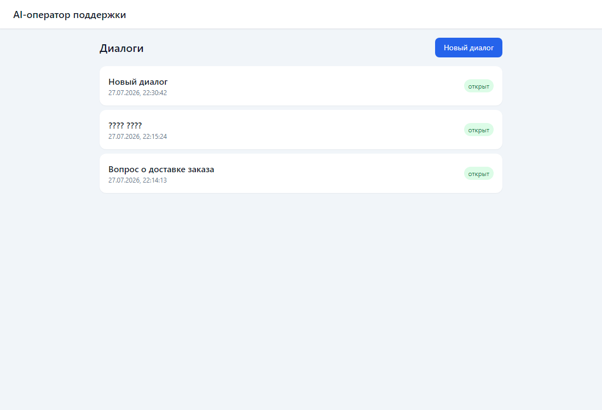
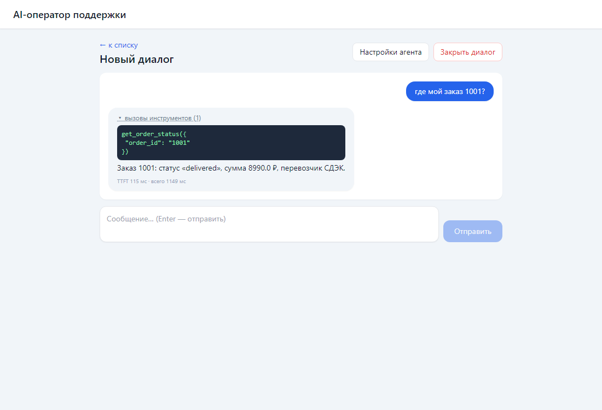

# AI-оператор поддержки (pet-проект)

Компактная веб-консоль оператора поддержки: диалог с пользователем текстом и голосовым звонком,
ответы генерирует LLM с вызовом инструментов (function calling) по данным из PostgreSQL.

Один домен — поддержка заказов. Демо-пользователь один (`DEMO_USER_ID` в `.env`), но RLS включён
и работает по-настоящему. Все внешние API (LLM/STT/TTS) подменяются моками через `.env` —
весь проект, включая голосовой конвейер, запускается без единого ключа.

## Стек

React 18 + TS + Vite + Tailwind + TanStack Query + RHF/Zod · FastAPI (async) + pydantic v2 + httpx ·
PostgreSQL 16 (миграции SQL, JSONB/GIN, PL/pgSQL RPC, триггеры, RLS) · asyncio-очередь с ретраями и DLQ ·
Asterisk 20 (ARI + ExternalMedia/RTP) · webrtcvad · STT/LLM/TTS через OpenAI-совместимые API.

## Архитектура

```mermaid
flowchart LR
    subgraph browser["Браузер"]
        UI["React-чат<br/>(SSE, optimistic UI)"]
    end
    subgraph backend["backend (FastAPI)"]
        API["REST /api/v1"]
        SSE["SSE /stream"]
        PIPE["LLM pipeline:<br/>tool loop + structured output"]
        WH["webhook /webhooks/crm<br/>(HMAC, идемпотентность)"]
        Q["asyncio-очередь<br/>ретраи → DLQ"]
    end
    subgraph telephony["telephony (Python)"]
        ARI["ARI Stasis app"]
        RTP["RTP ulaw 8k ↔ PCM 16k"]
        VP["VAD → STT → LLM → TTS<br/>barge-in"]
    end
    AST["Asterisk 20<br/>(ExternalMedia)"]
    DB[("PostgreSQL 16<br/>RLS · JSONB · RPC · триггеры")]
    CRM["CRM (эмулятор)"]

    UI <-->|REST + SSE| API
    API --> PIPE
    PIPE --> DB
    CRM -->|signed webhook| WH --> Q --> DB
    AST <-->|ARI REST/WS| ARI
    AST <-->|RTP ulaw| RTP --> VP
    VP -->|agent-turn (тот же pipeline)| API
```

## Запуск

```bash
cp .env.example .env          # по умолчанию всё на моках, ключи не нужны
docker compose up -d --build  # postgres + миграции + backend + frontend + asterisk + telephony
```

- UI: http://localhost:5173
- API: http://localhost:8000/docs
- Записи разговоров: http://localhost:8090

Для реального LLM: в `.env` поставить `LLM_PROVIDER=openai`, `LLM_BASE_URL`, `LLM_API_KEY`, `LLM_MODEL`
(любой OpenAI-совместимый провайдер). Аналогично `STT_PROVIDER`/`TTS_PROVIDER`.

## Демо каждого навыка за 5 минут

### 1. Чат со стримингом, function calling, structured output
Откройте http://localhost:5173 → «Новый диалог» → напишите «где мой заказ 1001?».
Ответ стримится пословно (SSE); в сообщении — коллапсируемый блок `get_order_status({"order_id": "1001"})`
с реальными данными из БД и футер `TTFT … мс · всего … мс`. Кнопка «Стоп» обрывает поток (AbortController).
Обрыв SSE (например, `docker compose restart backend` во время генерации) → индикатор
«переподключение, попытка N/3» с экспоненциальным backoff.
Structured output: финальный ответ LLM валидируется pydantic-схемой `AgentReply`,
при невалидном JSON — 1 автоматический retry (лог backend: `invalid structured output`).

### 2. Настройки агента (RHF + Zod)
На странице диалога → «Настройки агента»: системный промпт и температура,
Zod-валидация (температура 0–2), сохранение mutation'ом — следующий ответ учитывает промпт.

### 3. Webhook: HMAC, идемпотентность, очередь, DLQ
```bash
python scripts/webhook_sender.py --repeat       # 1-я отправка accepted, 2-я duplicate (в БД одна запись)
python scripts/webhook_sender.py --bad-sign     # HTTP 401
python scripts/webhook_sender.py --type crm.ping # неизвестный тип → 3 ретрая → DLQ
curl localhost:8000/api/v1/admin/dlq            # просмотр DLQ
docker compose exec db psql -U postgres -d ai_support -c "SELECT * FROM webhook_events;"
```

### 4. RPC, триггер, JSONB
```bash
# закрыть диалог кнопкой «Закрыть диалог» или:
docker compose exec db psql -U postgres -d ai_support -c \
  "SELECT close_conversation('<conversation_id>');"
# stats (JSONB) посчитаны внутри PL/pgSQL, статус сменился; audit-запись:
docker compose exec db psql -U postgres -d ai_support -c "SELECT * FROM conversation_events;"
# запрос по JSONB с GIN-индексом:
docker compose exec db psql -U postgres -d ai_support -c \
  "SELECT id FROM messages WHERE metadata @> '{\"tool_calls\": [{\"name\": \"get_order_status\"}]}';"
```

### 5. RLS
```sql
SET ROLE app_user;
SET app.user_id = '00000000-0000-0000-0000-000000000001';
SELECT count(*) FROM conversations;   -- свои диалоги
SET app.user_id = '00000000-0000-0000-0000-000000000099';
SELECT count(*) FROM conversations;   -- 0 строк: чужие не читаются
RESET ROLE;
```
Backend выставляет `SET LOCAL app.user_id` на каждую транзакцию (`backend/app/db.py`).

### 6. Голосовой конвейер (sim-режим без SIP-транка)
```bash
python scripts/make_wav.py            # тестовые WAV (уже сгенерированы в scripts/audio)
# полный цикл WAV → STT(mock) → LLM → TTS(mock) → playback:
docker compose --profile sim run --rm --no-deps sim --wav /scripts/audio/utt1.wav --out /tmp/reply.wav
# barge-in: вторая реплика перебивает ответ:
docker compose --profile sim run --rm --no-deps sim --wav /scripts/audio/utt1.wav --barge /scripts/audio/utt2.wav
docker compose logs telephony | grep -E "barge-in|latency|stt final"
```
В логах: частичные гипотезы STT, финальный транскрипт, tool_calls LLM, фактическая задержка
«конец реплики → начало ответа» (на моках в тёплом состоянии ~400–500 мс; первый запрос после
старта контейнеров медленнее — установка соединений).

Реальный софтфон (опционально): Zoiper/Linphone → SIP `sip:1000@localhost:5060` (без регистрации,
анонимный endpoint в `telephony/asterisk/pjsip.conf`) — звонок попадёт в Stasis, дальше тот же конвейер.
Запись разговора (две дорожки in/out) появится на http://localhost:8090.

### Диагностика телефонии
- SIP-трейс: `docker compose exec asterisk sngrep` (или `asterisk -rvvv` → `pjsip set logger on`).
- Логи задержек и VAD/barge-in: `docker compose logs -f telephony`.
- ARI-события: `docker compose logs asterisk`, websocket — `websocat "ws://localhost:8088/ari/events?app=ai-support&api_key=ari:ari_secret"`.
- RTP не идёт: проверить, что ExternalMedia создан (`curl -u ari:ari_secret localhost:8088/ari/channels`) и порт 10000/udp проброшен.

## Миграции

`db/migrations/*.sql` — идемпотентные (`IF NOT EXISTS`), применяются `db/migrate.py` (таблица `schema_migrations`),
откат последней: `docker compose run --rm migrate python /db/migrate.py down`.
Seed: 3 заказа (1001–1003), 1 диалог с историей.

## Структура

```
frontend/    React 18 + Vite: чат с SSE-стримингом, useSSE (backoff, AbortController), RHF+Zod форма
backend/     FastAPI: /api/v1 CRUD + SSE, LLM pipeline (tools, structured output), webhook, очередь+DLQ
db/          миграции SQL (таблицы, GIN, RPC close_conversation, триггеры, RLS) + seed + migrate.py
telephony/   Asterisk-конфиг + Python: ARI Stasis, RTP 8↔16кГц, VAD, STT→LLM→TTS, barge-in
scripts/     webhook_sender.py (HMAC, --repeat, --bad-sign), sim_call.py, make_wav.py
```

## Скриншоты

| Список диалогов | Чат со стримингом и tool_call |
|---|---|
|  |  |
